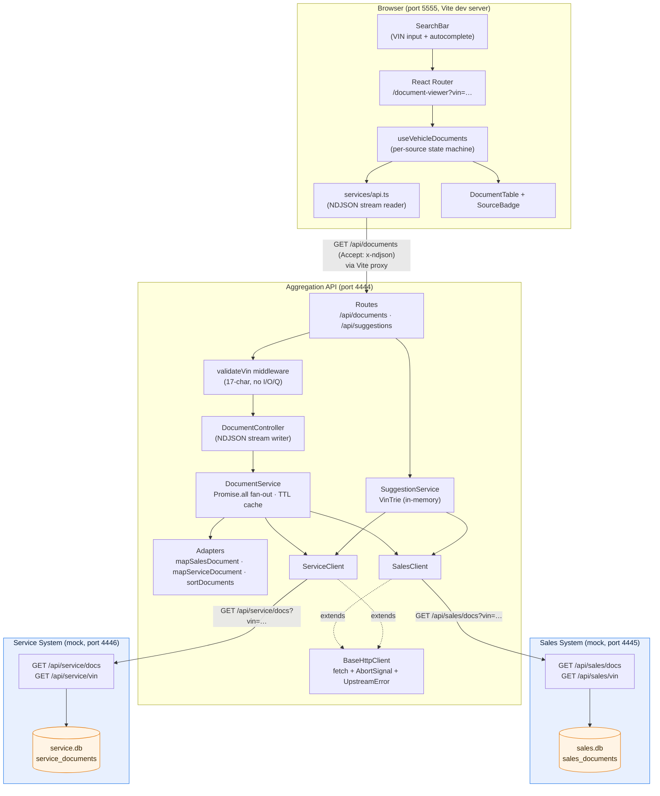
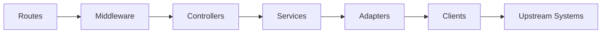
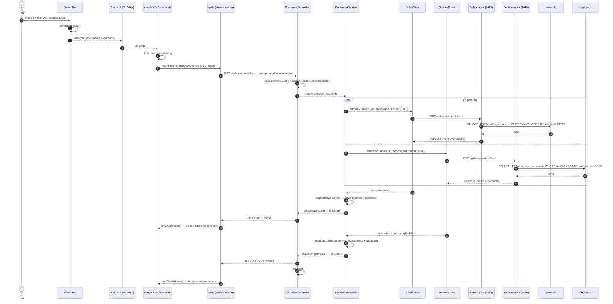
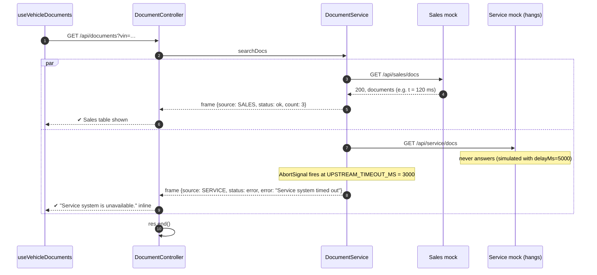
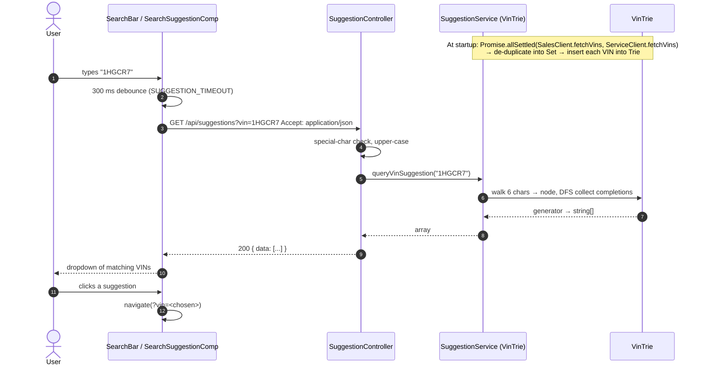
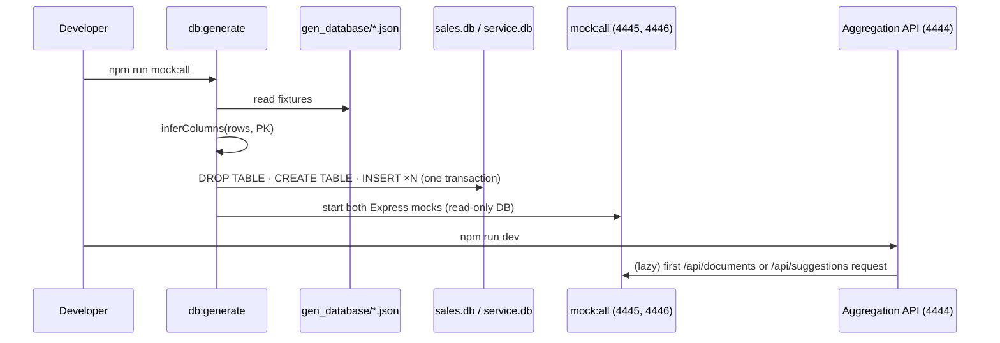

# Part 1 — System Design Document
## Scenario D: The Unified Document Viewer

> A single search interface that returns **every document related to a vehicle (VIN)**,
> aggregated in real time from two independent, mocked dealership systems — the
> **Sales System** and the **Service System**.

---

## Table of contents

1. [Problem statement & scope](#1-problem-statement--scope)
2. [Requirements traceability](#2-requirements-traceability)
3. [Architecture overview](#3-architecture-overview)
4. [Architecture diagram](#4-architecture-diagram)
5. [Component descriptions](#5-component-descriptions)
6. [Data flow](#6-data-flow)
7. [Technology choices & justifications](#7-technology-choices--justifications)
8. [Observability strategy](#8-observability-strategy)
9. [Non-functional design](#9-non-functional-design)
10. [How GenAI was used in the design phase](#10-how-genai-was-used-in-the-design-phase)
11. [Known limitations & next steps](#11-known-limitations--next-steps)
12. [Appendix — repository map](#12-appendix--repository-map)

---

## 1. Problem statement & scope

A car dealership group runs two separate back-office systems:

| System | Owns | Port (mock) |
|---|---|---|
| **Sales System** | Sales contracts, invoices, finance/lease agreements, insurance policies | `4445` |
| **Service System** | Repair orders, warranty claims, service invoices | `4446` |

Neither system knows the other exists. A user (e.g. a service advisor at the desk)
needs **one place** to type a VIN and see **all** documents from **both** systems,
with a clear label of which system each document came from.

### In scope
- Unified VIN search UI.
- Backend aggregation service that calls both upstreams **in parallel**.
- A single, consolidated view, **clearly indicating the source system** per document.
- Per-source graceful degradation (if one system is down, the other still renders).

### Out of scope (deliberately)
- Authentication / authorisation (described in §11 as the next step).
- Real dealership system integrations — both upstreams are mocked.
- Document preview / PDF rendering — documents are linked by `file_url`.
- Persistence of search history.

---

## 2. Requirements traceability

| Requirement (from brief) | Where it is implemented | Notes |
|---|---|---|
| **1. Unified search** — single interface, user enters a VIN | `frontend/src/features/document-viewer/components/SearchBar.tsx`, input validation in `backend/src/middlewares/validation.middleware.ts` | VIN lives in the URL (`?vin=`) so results are shareable/bookmarkable |
| **2. Data aggregation** — backend makes **parallel** requests to Sales + Service APIs | `backend/src/services/document.service.ts` (`Promise.all` over two independent `_fetchSource` calls) | Each source uses its own `AbortSignal.timeout()` — see §6.2 |
| **3. Aggregated view** — single consolidated list, source clearly indicated | `frontend/src/features/document-viewer/components/DocumentTable.tsx` + `SourceBadge.tsx` | Coloured `SALES` / `SERVICE` badge per row; expanding a row reveals source-specific fields |
| **Service layer fully implemented** — RESTful API + persistent database | `backend/` (Express + TypeScript + SQLite) | Frontend is fully implemented too, not stubbed |
| **Build for the future** — scalability, performance, reliability, observability | §8, §9 | Streaming, per-source isolation, caching, timeouts, circuit-friendly error model |

---

## 3. Architecture overview

The system is a **three-tier streaming aggregation architecture**:

```
 Browser (React SPA)
        │  GET /api/documents?vin=…   Accept: application/x-ndjson
        ▼
 Aggregation API (Express, port 4444)          ← the "service layer" chosen for full implementation
        │  ── Promise.all ──┐
        ▼                   ▼
 Sales System mock      Service System mock
 (port 4445, SQLite)    (port 4446, SQLite)
```

Three design decisions define the shape of the system:

### 3.1 Fan-out, not chain
The aggregation service does **not** call Sales and then Service. It launches both
calls concurrently (`Promise.all`) and each runs with its own timeout signal. Total
latency is therefore `max(sales, service)` rather than `sales + service`.

### 3.2 Stream per source, don't wait for the slowest
The classic fan-out pattern waits for *everything* before responding, which means the
user stares at a spinner until the slower dealership system answers — and sees
**nothing** if it is down. Instead, the API responds with
`Content-Type: application/x-ndjson` and **streams one JSON frame per upstream**,
written the moment that upstream answers:

```json
{"success":true,"message":"3 documents found.","vin":"1HGCR2F83HA000021","source":"SALES","documents":[...],"sources":{"status":"ok","count":3}}
{"success":true,"message":"Service system timed out","vin":"1HGCR2F83HA000021","source":"SERVICE","documents":[],"sources":{"status":"error","count":0,"error":"Service system timed out"}}
```

The frontend reads the stream incrementally, so the **fast source renders first**
and each section (Sales / Service) manages its own `loading → ok | empty | error`
state.

> **Lifecycle guarantee.** A frame is only ever written when a source settles one way
> or the other: `ok` (≥ 1 document), `empty` (successful answer, 0 documents) or `error`
> (timeout, unreachable, non-2xx, malformed payload). There is no "partial" state, so a
> section that has not received its frame is, by definition, still loading and its
> spinner is accurate.

> **Why NDJSON and not SSE or WebSocket?** The data is a small, finite, request-scoped
> burst — not an ongoing feed. NDJSON over a plain HTTP `GET` keeps it a normal REST call
> (cacheable headers, easy `curl` testing, no extra protocol), while giving the browser
> a readable `ReadableStream`. SSE would add an event protocol for no benefit; WebSocket
> is for bidirectional/long-lived sessions we do not have.

### 3.3 Failure is per source, never global
`_fetchSource` **resolves** (never rejects) with an `error` frame on timeout,
unreachability, bad HTTP status, or malformed payload (`UpstreamError` in
`clients/base.client.ts`). A dead Service system cannot take down a Sales result.
Only a genuine bug in the aggregator itself reaches the Express error middleware.

### 3.4 Supporting capability: VIN autocomplete (Trie)
A second endpoint, `GET /api/suggestions?vin=<prefix>`, exposes VINs from both systems
to power type-ahead in the search bar. It uses an in-memory **Trie** (`suggestion.service.ts`)
loaded once at startup from both upstreams — prefix lookup is **O(|prefix| + k)** where
`k` is the number of matches, instead of scanning every VIN on every keystroke.
This is a demonstration of structuring a second, independently-designed module in the
same codebase.

---

## 4. Architecture diagram

### 4.1 Component / deployment diagram



### 4.2 Layering (backend)



Each layer depends only on the layer to its right:

| Layer | File(s) | Responsibility |
|---|---|---|
| Routes | `routes/api.routes.ts`, `document.routes.ts`, `suggestion.routes.ts` | Map URL → middleware chain + controller |
| Middleware | `validation.middleware.ts`, `error.middleware.ts` | Reject bad input before any work; centralise error responses |
| Controllers | `document.controller.ts`, `suggestion.controller.ts` | HTTP concerns only: content negotiation, headers, streaming, status codes |
| Services | `document.service.ts`, `suggestion.service.ts` | Core business logic: fan-out, per-source failure isolation, cache, Trie |
| Adapters | `adapters/document.adapters.ts` | Translate raw Sales/Service shapes → `IUnifiedDocument`; sorting |
| Clients | `base.client.ts`, `sales.client.ts`, `service.client.ts` | HTTP to upstreams, timeouts, `UpstreamError` |
| Config | `config/env.config.ts` | Single source of every tunable/env value |

---

## 5. Component descriptions

### Backend

| Component | Role |
|---|---|
| **`app.ts`** | Express bootstrap. JSON/urlencoded body parsers, `/api` request logging middleware, mounts `ApiRoutes`, `/health` liveness probe, error handler last. |
| **`config/env.config.ts`** | Loads `backend/.env` and exports typed `ENV` with defaults: ports, upstream URLs, `UPSTREAM_TIMEOUT_MS` (3000), `CACHE_TTL_MS` (60000), fixture/db paths, artificial upstream latency (for fault-injection demos). |
| **`routes/api.routes.ts`** | Composes `/api/documents` and `/api/suggestions` routers. |
| **`middlewares/validation.middleware.ts`** | `validateVin` — VIN must be exactly 17 chars `[A-HJ-NPR-Z0-9]` (I/O/Q excluded), normalises to upper-case and passes it downstream. `validateIfAnySpecialChar` — looser check for the suggestion prefix endpoint (any alphanumeric prefix allowed). |
| **`middlewares/error.middleware.ts`** | Final Express error handler. Logs, maps `statusCode`, never leaks internal messages or stack in production. |
| **`controllers/document.controller.ts`** | Content negotiation (`Accept: application/x-ndjson`, else `406`), sets streaming headers (`Content-Type`, `Cache-Control: no-cache`, `X-Accel-Buffering: no`), `flushHeaders()`, builds the user-facing message per frame, writes one NDJSON line per source, aborts upstream work if the client disconnects. |
| **`controllers/suggestion.controller.ts`** | `Accept: application/json` required, returns `{ data: string[] }` of VINs that start with the typed prefix. |
| **`services/document.service.ts`** | **The aggregator.** `searchDocs(vin, onChunk)` launches Sales and Service concurrently; each `_fetchSource` has its own timeout, cache check, adapter mapping, sort and status derivation, and converts every failure into an `error` frame. |
| **`adapters/document.adapters.ts`** | The *only* place that knows the difference between raw Sales and Service shapes. Produces `IUnifiedDocument` (common fields + `details` bag for source-specific fields). `sortDocuments` orders newest-first, nulls last. |
| **`clients/base.client.ts`** | Abstract singleton client. `getDocuments<T>` performs `fetch` with an `AbortSignal`, translates abort → timeout error, non-2xx → HTTP error, malformed body → payload error, all as `UpstreamError`. |
| **`clients/sales.client.ts` / `service.client.ts`** | Thin, typed wrappers for `/api/{sales,service}/docs` and `/api/{sales,service}/vin`; inject optional latency for demos. |
| **`services/suggestion.service.ts`** | Loads all VINs from both systems once (`Promise.allSettled`), de-duplicates into a `Set`, builds a `VinTrie`; `query(prefix)` DFS-walks to the prefix node and yields completions. |
| **`mocks/*.server.ts`** | Two standalone Express apps, each on its own port/DB, exposing `/docs?vin=`, `/vin`, `/health`. Support an artificial `delayMs` (≤ 10 s) for demonstrating timeouts. |
| **`database/sqlite.config.ts`** | `buildDatabaseFromJson` — rebuilds a SQLite DB from a JSON fixture, inferring column types and the PK from the data, inside one transaction (roll back on failure). `DocumentStore` — read-only connection with `findByVin` (~indexed lookup) and `loadAllVin`. |
| **`database/generate.ts`** | Seed script (`npm run db:generate`) run before mocks start. |

### Frontend

| Component | Role |
|---|---|
| **`main.tsx`** | Mounts React, `BrowserRouter`, redirects `/` → `/document-viewer`. |
| **`App.tsx`** | Page shell: header with title + `SearchBar`, main with `DocumentViewerContainer`. |
| **`SearchBar.tsx`** | VIN input; upper-cases input, validates before navigating, pushes `?vin=` to the URL. Hosts the autocomplete component. |
| **`SearchSuggestionComp`** (inside `SearchBar.tsx`) | Type-ahead: 300 ms debounce, aborts the previous request on each keystroke, renders a dropdown (loading spinner → VIN list), click navigates to that VIN's results. |
| **`useVehicleDocuments.ts`** | Per-source state machine. Initialises both sources to `loading`; replaces only the source that a frame belongs to; aborts the previous stream when the VIN changes so stale frames never win; surfaces whole-request failures separately. |
| **`services/api.ts`** | `fetchDocumentsByVin` — reads the NDJSON stream with a `TextDecoder` buffer, parses complete lines as they arrive, invokes `onChunk` per frame. `fetchSuggestionsByVinSubstr` — JSON fetch for autocomplete. |
| **`DocumentViewerContainer.tsx`** | Renders one `SourceSection` per system independently: spinner while loading, error text if that system failed, table of documents if it answered. |
| **`DocumentTable.tsx`** | Consolidated table — Source badge, ID, type, date, amount, status, PDF link. Clicking a row expands source-specific `details` (salesperson, advisor, technician, odometer…). |
| **`SourceBadge.tsx`** | Blue `SALES` / green `SERVICE` pill — the "clearly indicate the source system" requirement. |
| **`types/document.types.ts`** | Frontend mirror of the backend contract + `isValidVin` (same regex as backend). |
| **`utils/formatters.ts`** | Pure formatters: date (`en-GB`, `—` when null), currency (`en-US` USD), document type (underscores → spaces), odometer (thousands + `km`). |

---

## 6. Data flow

### 6.1 End-to-end search flow (happy path)



### 6.2 When one system is slow or down (degraded path)



Key properties shown above:
- **Sales renders at ~120 ms** — it never waits for Service.
- **Timeout is per source**, enforced by `AbortSignal.timeout(ENV.UPSTREAM_TIMEOUT_MS)` inside `_fetchSource`, so a hanging upstream cannot hold the connection open.
- **Client disconnect** — `res.on('close')` ends the response; the controller checks `res.writableEnded` before every write.
- **Empty result** is distinct from error: `{status: 'empty', count: 0}` produces "No documents found for this VIN." in that section only.

### 6.3 Autocomplete flow



### 6.4 Startup / seeding flow



---

## 7. Technology choices & justifications

### Backend

| Choice | Why |
|---|---|
| **Node.js (≥ 20) + TypeScript** | Native `fetch`, `AbortSignal.timeout` and web streams mean the aggregation layer needs **zero HTTP dependencies**. TypeScript gives the shared `IUnifiedDocument` contract real compile-time safety across adapter/client/service boundaries — the contract *is* the documentation. |
| **Express 4** | Smallest viable routing + middleware model; the whole app surface is 2 routes. Using the same framework for the mocks keeps the repo to one mental model. |
| **Native `fetch` instead of Axios/Undici client** | One dependency fewer; `AbortSignal` support is first class; sufficient for JSON GETs. The repository structure doc mentions Axios as an earlier idea — the final implementation uses native `fetch` (`base.client.ts`). |
| **SQLite (`sqlite` + `sqlite3`)** | Real persistent storage for the mock upstreams with **zero operational setup**, so reviewers can run everything with `npm install`. Each dealership system gets its **own database file**, reinforcing that they are independent systems. Easily swapped for Postgres/MySQL behind `DocumentStore`. |
| **NDJSON streaming over plain `GET`** | See §3.2. Standard HTTP, testable with `curl`, no protocol overhead. |
| **`Promise.all` of two self-contained `_fetchSource` calls** | Fan-out concurrency + per-source error isolation in one construct. `_fetchSource` *never* rejects, so `Promise.all` cannot fail due to an upstream. |
| **Abstract singleton `BaseHttpClient`** | One place for timeout/error translation; subclasses are 10-line, typed, testable wrappers. |
| **In-memory `Map` TTL cache (per VIN+source)** | Repeated searches don't re-hit upstreams. TTL (60 s) bounds staleness. Cache is applied **after** a successful fetch — an outage is never masked by a cached result (§11 notes the in-flight path). |
| **`VinTrie`** | Prefix search cost independent of dataset size; O(|prefix| + k) per query. |
| **Constructor-based DI (no container)** | All dependencies are classes instantiated in constructors; no framework needed, trivial to mock in tests. |
| **`tsx`** | Run TypeScript directly in dev (`tsx watch`) and tests (`tsx --test`) with no build step; `tsc` builds for production. |

### Frontend

| Choice | Why |
|---|---|
| **React 19 + TypeScript** | Component model fits the per-source independent rendering requirement cleanly. |
| **Vite 6** | Instant dev server, native ESM, and a built-in **`/api` proxy** so the browser never deals with CORS or the backend's absolute URL. |
| **React Router 7** | The VIN lives in the URL (`/document-viewer?vin=…`), making every result page shareable and reloadable. |
| **Native streaming via `response.body.getReader()`** | Shows the slow source's results without waiting for the fast source — the central UX benefit. |
| **Per-source state map in a custom hook** | Encapsulates the loading/ok/empty/error lifecycle and abort logic, keeping the container a pure renderer. |
| **No state library** | The state is 3 fields in one hook. Redux would be overhead. |
| **No UI library** | Assessment constraint and keeps the bundle small; inline styles keep the demo self-contained. |

**Explicit non-choices:** GraphQL (no need for client-driven query shape), Kafka (repository-structure notes mention it as an early idea — there is no eventing requirement), Redis (no shared cache need at this scale), server-side rendering (search results are user-specific and ephemeral).

---

## 8. Observability strategy

### What exists today

| Signal | Implementation | Where |
|---|---|---|
| **Request log** | `[Incoming Request]: METHOD /url` for every `/api` call | `app.ts` request-logging middleware |
| **Upstream failure log** | `[document-service] {SALES\|SERVICE} upstream failure: <message>` — every timeout/unreachable/bad-payload is logged with its source | `document.service.ts` |
| **Stream error log** | `Error while stream data: …` | `document.controller.ts` |
| **Content negotiation trace** | `[SEARCH DOCS] content type … accept headers …` | controllers |
| **Startup banner** | Listening port + configured upstream URLs | `app.ts` |
| **Health endpoint** | `GET /health` → `{status: "OK", timestamp}` | `app.ts`; each mock also exposes `/health` |

### The design principles behind it

1. **Log at the seams, not everywhere.** The three places a request can fail —
   upstream call, service, HTTP write — each have exactly one log line carrying the
   source and reason. A log line names the *system* (`SALES` / `SERVICE`) so you can
   see in production which dealership is degrading.
2. **Health is separate from upstream liveness.** `/health` proves the aggregator
   process is up. Upstream health is visible per-request in the frames and the mock
   `/health` endpoints — intentional, since an aggregation service should stay healthy
   while one upstream is down (it degrades, it doesn't die).
3. **Status is part of the payload.** Every NDJSON frame carries
   `sources: {status, count, error?}`. The frontend's error/empty view is driven by the
   server's view, so user-visible behaviour can't silently diverge from server-side
   truth.

### Production roadmap (designed, not yet implemented)

| Theme | Plan |
|---|---|
| **Structured logging** | Replace `console.*` with `pino`/`winston`, JSON lines containing `requestId` (generated middleware), `vin` (hashed in prod — VIN is PII-adjacent), `source`, `durationMs`, `outcome`. |
| **Metrics (RED / USE)** | `agg_request_total{status}`, `agg_request_duration_seconds` (histogram), **`upstream_request_duration_seconds{source,outcome}`**, `upstream_errors_total{source,cause}` (timeout / http_5xx / bad_payload / unreachable), `cache_hit_ratio{source}`. Expose `/metrics` (Prometheus). Split the facets by `source` so a degraded dealership is immediately visible. |
| **Distributed tracing** | OpenTelemetry auto-instrumentation for HTTP; one span per aggregation request, **child spans per upstream call** with `peer.service = sales|service`, so a slow upstream shows as the slow span. |
| **Alerting** | Page on `upstream_errors_total` rate per source > threshold; ticket on progressive p95 latency; watch `cache_hit_ratio.` |
| **Dashboards** | Per-source availability, p50/p95/p99 latency, stream time-to-first-frame and time-to-last-frame, cache hit ratio. |
| **Frontend** | Report whole-request errors and per-source error frames (with `source`) to the RUM backend. |
| **Build pipeline** | `tsc --noEmit` + `npm test` in CI; `X-Request-Id` propagated to upstreams for end-to-end correlation. |

---

## 9. Non-functional design

| Pillar | Target | How the design delivers it |
|---|---|---|
| **Scalability** | Horizontal | Aggregator is stateless except per-process caches. The only stateful piece — the VIN Trie — is read-mostly and rebuildable per instance; move it to a shared cache (Redis) when multiple replicas are needed. Connectors are interface-shaped (`BaseHttpClient` subclasses), so adding a third dealership system is one client + one adapter + one entry in `searchDocs`. |
| **Performance** | Latency ≤ slowest source + overhead | Parallel fan-out (`max(a,b)`), streaming first-byte-per-source, 60 s TTL cache, indexed `WHERE vin = ?`, Trie O(|prefix|+k) autocomplete, 300 ms client debounce + request abort. |
| **Reliability** | One upstream down ≠ feature down | Per-source timeout (3 s), per-source error frames, `Promise.all` over non-rejecting fetches, client disconnect handling, read-only monitor connection, transactional DB build. |
| **Maintainability** | Small change locality | Strict layering (route→middleware→controller→service→adapter→client); the *only* source-specific code is `document.adapters.ts`; one typed contract per side; config centralised in `env.config.ts`. |
| **Observability** | Diagnosable incidents | §8. |
| **Security** | Input validated before use | VIN regex limits input to 17 `[A-HJ-NPR-Z0-9]` chars; parameterised SQL everywhere (`?` placeholders), identifiers quoted (`quoteIdentifier`) and never from user input; provider errors not leaked to clients (generic 500). |

---

## 10. How GenAI was used in the design phase

> This section is written to be honest about the collaboration model rather than a
> sales pitch.

### 10.1 Overall strategy — treat the model as a *design reviewer*, not a *designer*

I owned the requirements interpretation and the core architectural decision
(parallel fan-out with per-source isolation + streaming). I used GenAI to **(a) pressure-test
that decision**, **(b) enumerate the failure modes I could miss**, and **(c) accelerate
the tedious, low-judgement parts** (boilerplate, doc skeletons, Mermaid diagrams).

Prompts were given **context first**: the scenario brief, the existing folder layout,
the contracts (`IUnifiedDocument`), and the specific question — followed by an explicit
"list the risks / alternatives I'm not considering" request, rather than "design my system".

### 10.2 Specific contributions

| Design area | How AI helped | What I kept / discarded |
|---|---|---|
| **Aggregation pattern** | Compared *wait-all* fan-out vs *stream-per-source*; enumerated UX consequences of a slow upstream (spinner deadlock). | Took streaming; rejected SSE and WebSocket for a one-shot burst (§3.2). |
| **Failure model** | Produced a matrix of upstream failure modes (timeout / unreachable / 5xx / malformed body / partial success) and how each should surface. | Kept; this became `UpstreamError` categories and the per-source `error` frame. |
| **Contract design** | Drafted the `IUnifiedDocument` shape with a free-form `details` bag for source-specific fields. | Kept — this is what lets both systems share one table without a union type explosion. |
| **Schema drift** | Flagged that hand-written columns drift from fixtures (the `customer_name` / `event_date` problem noticed during development); proposed inferring the schema from the JSON rows. | Kept — `inferColumns` + `DROP/CREATE` on every seed. |
| **VIN autocomplete** | Suggested Trie vs binary search vs linear scan with complexity analysis. | Kept Trie; simplified the AI's API (removed build-time factories) to a plain class with a generator-based `query`. |
| **Documentation/diagrams** | Generated Mermaid skeletons and section headings for this document. | Validated every component name, header and code path against the actual files; rewrote for accuracy and voice. |

### 10.3 Verification & refinement process

1. **Ground every claim in code.** Each design statement in this document was
   cross-checked against the file it describes; AI suggestions referencing APIs or
   behaviours that did not exist in this codebase were dropped.
2. **Trace the failure path by hand.** For each failure mode, I confirmed the actual
   code path (`_fetchSource` catch → frame → controller `res.write` → hook `setSources`)
   rather than trusting the AI's description.
3. **Fault injection, not assumption.** The mocks accept `delayMs`; setting
   `SALE_LATENCY_MS=5000` (above the 3 s timeout) is how the degraded-path behaviour in
   §6.2 was verified in the browser, not just reasoned about.
4. **Keep the human decision visible.** Where AI output and my judgement disagreed
   (e.g. an "event-driven unified graph" over both systems built on Kafka), I kept the
   simpler design the brief supports — the module list and API surface must remain
   explainable end-to-end.
5. **Code review checklist per AI-assisted change:** does it cross a layer boundary?
   does it leak upstream-specific knowledge outside the adapter? does it fail a whole
   request for a single-source problem? is it typed (no `any` in new code)?

### 10.4 Divergence between plan and build (and how it was caught)
- The repository notes (`repo_structure.md`) mention **Axios** and **Kafka consumers**.
  During implementation these were dropped: native `fetch` covers the needs (and gives
  first-class `AbortSignal`), and there is no eventing requirement in Scenario D.
  The design was corrected **from reading the code**, not from the AI's summary of it —
  a reminder to verify generated design docs against the repository.
- The suggestion endpoint initially assumed VIN arrays; the actual upstream `/vin`
  endpoints return `{success, count, documents}` where documents are `{vin}` objects.
  Caught by checking the mock server code and adjusting `SuggestionService` accordingly.

### 10.5 What I would do differently
- Write the **failure-mode test matrix before** asking the model for a design, so the
  prompt asks the model to fill a grid rather than propose one.
- Separate "design exploration" sessions from "documentation drafting" sessions — mixing
  them lets generated prose subtly over-claim features that aren't built.
- Keep an ADR (architecture decision record) file per decision (streaming vs wait-all,
  SQLite vs Postgres, Trie vs scan) with the rejected alternatives — Section 3 is really
  a first draft of this.

---

## 11. Known limitations & next steps

| # | Gap | Impact | Suggested next step |
|---|---|---|---|
| 1 | **Cache is consulted after the fetch** (`_fetchSource` awaits the upstream, *then* checks the cache). | The 60 s TTL does **not** save upstream latency today; it only serves a cached outcome when a live call *succeeds*. An upstream outage is therefore never masked by a cached result — a deliberate correctness choice — but the performance benefit is not realised. | Check the cache **before** the fetch; add in-flight request coalescing (a `Map<key, Promise>`) so concurrent identical searches share one upstream call. |
| 2 | Upstream VIN list is loaded **once at startup** into the Trie; `SuggestionService` is constructed per controller instance. | New VINs added after boot won't autocomplete until restart; a failed initial fetch leaves the Trie empty for the process lifetime. | Refresh periodically (or on TTL), retry with backoff, and share one service instance per process. |
| 3 | **No automated tests** in the repository yet although `npm test` is wired (`tsx --test test/**/*.test.ts`). | Regressions in mapping/sorting/error frames catchable only manually. | Unit: adapters, `sortDocuments`, `validateVin`, `UpstreamError` mapping. Integration: supertest the NDJSON stream with both mocks (and one mock down). Frontend: hook tests with a mocked stream. |
| 4 | No structured logging, metrics or tracing. | Incidents require log grepping. | §8 production roadmap. |
| 5 | No auth / rate limiting. | Any client can query any VIN. | API gateway auth, per-user rate limits; hash VINs in logs (PII). |
| 6 | Cache is unbounded in memory. | Slow memory growth on highly diverse VIN traffic. | LRU bound (e.g. 10 k entries) or Redis with TTL. |
| 7 | Frontend `SearchBar` contains commented-out validation-error UI. | Minor read noise. | Re-expose or delete. |
| 8 | **Timeout is labelled "unreachable"** — `BaseHttpClient.getDocuments` checks `error.name === 'AbortError'` on the fetch rejection, but Node's `fetch` wraps aborts in `TypeError('fetch failed')` with an `AbortError` **cause**. | Deadline is still enforced (verified: completes at ~3.09 s with a 5 s upstream delay) and the user sees "unavailable", but the message cannot tell an outage from a timeout. | Check `error.cause?.name === 'AbortError'` or `signal.aborted` to classify timeouts. |

---

## 12. Appendix — repository map

```
The-Unified-Document-Viewer/
├── README.md                     # quick start
├── docs/                         # ← Part 1 deliverables
│   ├── 01-system-design.md              # this document
│   ├── 02-sequence-diagrams.md          # all runtime sequences
│   ├── 03-module-complexity-analysis.md # time/space complexity per module
│   ├── 04-api-contract.md               # REST + NDJSON contract
│   └── 05-ai-collaboration.md           # AI engineering narrative
├── gen_database/                 # fixtures + Python generator
│   ├── gen_data.py
│   ├── sales_data.json
│   └── service_data.json
├── backend/                      # REST API (Express + TS + SQLite)  → port 4444
│   ├── .env
│   ├── database/{sales,service}.db
│   └── src/
│       ├── app.ts
│       ├── config/env.config.ts
│       ├── routes/{api,document,suggestion}.routes.ts
│       ├── middlewares/{validation,error}.middleware.ts
│       ├── controllers/{document,suggestion}.controller.ts
│       ├── services/{document,suggestion}.service.ts
│       ├── adapters/document.adapters.ts
│       ├── clients/{base,sales,service}.client.ts
│       ├── interfaces/document.interface.ts
│       ├── database/{sqlite.config,generate}.ts
│       └── mocks/{sales-mock,service-mock,start-all-mocks}.ts  → ports 4445 / 4446
└── frontend/                     # React SPA (Vite)  → port 5555
    └── src/
        ├── main.tsx · App.tsx
        ├── components/{Button,InputField,LoadingSpinner}.tsx
        ├── constants/{api.endpoints,config}.ts
        ├── features/document-viewer/
        │   ├── DocumentViewerContainer.tsx
        │   ├── components/{SearchBar,DocumentTable,SourceBadge}.tsx
        │   └── hooks/useFetchDocuments.ts
        ├── services/api.ts
        ├── types/document.types.ts
        └── utils/formatters.ts
```

**Ports:** aggregation API `4444` · Sales mock `4445` · Service mock `4446` · frontend dev `5555`.
