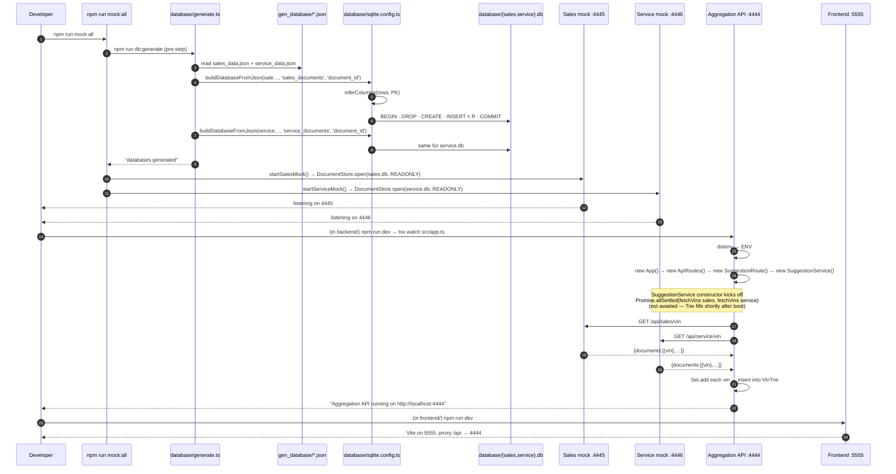
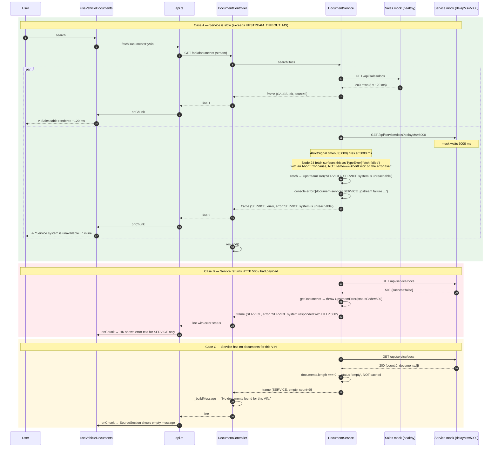
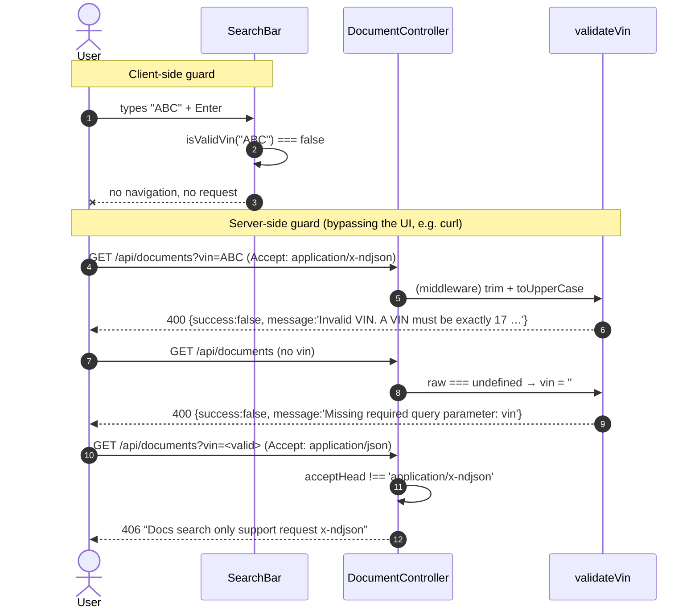
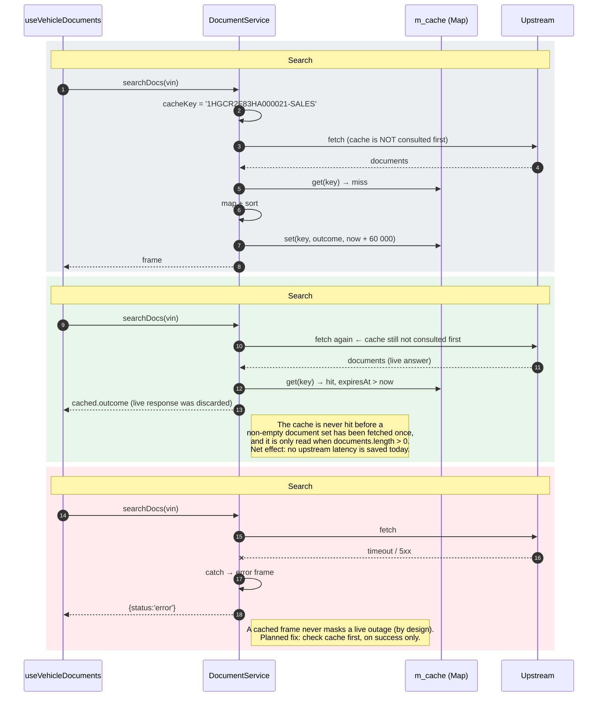
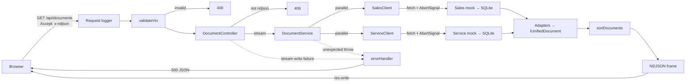

# Sequence Diagrams

Runtime interaction diagrams for every flow in the Unified Document Viewer.
All diagrams are [Mermaid](https://mermaid.js.org/) and render natively on GitHub.

## Index

| # | Diagram | Type | Purpose |
|---|---|---|---|
| 1 | Startup & seeding | sequence | DB generation, mock bootstrap, aggregator boot |
| 2 | Happy-path search | sequence | end-to-end streamed aggregation |
| 3 | Degraded search (one upstream slow/down) | sequence | per-source isolation + timeout |
| 4 | Invalid / missing VIN | sequence | validation short-circuit |
| 5 | Client disconnect mid-stream | sequence | cancellation / resource cleanup |
| 6 | Autocomplete | sequence | debounce, Trie lookup, navigation |
| 7 | Cache behaviour | sequence | what the TTL cache actually does |
| 8 | Layer flow (alt view) | flowchart | request → response path by layer |

---

## 1. Startup & seeding



---

## 2. Happy-path search

```mermaid
sequenceDiagram
    autonumber
    actor U as User
    participant SB as SearchBar
    participant Rt as React Router
    participant VC as DocumentViewerContainer
    participant HK as useVehicleDocuments
    participant AP as services/api.ts
    participant VX as Vite proxy
    participant Ct as DocumentController
    participant Sv as DocumentService
    participant SC as SalesClient
    participant VC2 as ServiceClient
    participant SM as Sales mock
    participant VM as Service mock
    participant DT as DocumentTable

    U->>SB: types 1HGCR2F83HA000021 + Enter
    SB->>SB: isValidVin()
    SB->>Rt: navigate('/document-viewer?vin=1HGCR2F83HA000021')
    Rt->>VC: render with ?vin
    VC->>HK: useVehicleDocuments('1HGCR2F83HA000021')
    HK->>HK: setSources(all → loading), setError(null)
    HK->>AP: fetchDocumentsByVin(vin, onChunk, controller.signal)

    AP->>VX: GET /api/documents?vin=…  Accept: application/x-ndjson
    VX->>Ct: forward to :4444
    Ct->>Ct: Accept === 'application/x-ndjson' ? proceed : 406
    Ct->>Ct: res.status(200), x-ndjson, no-cache, X-Accel-Buffering:no
    Ct->>Ct: res.flushHeaders(); res.on('close', onClose)
    Ct->>Sv: searchDocs(vin, onChunk)

    par Concurrent fan-out
        Sv->>SC: fetchDocuments(vin, AbortSignal.timeout(3000))
        SC->>SM: GET /api/sales/docs?vin=…&delayMs=0
        SM->>SM: findByVin('sales_documents', vin, 'sale_date')
        SM-->>SC: 200 {success, count, documents}
        SC->>SC: res.json() → validate success + array
        SC-->>Sv: IRawSalesDocument[]
        Sv->>Sv: cache.get('VIN-SALES')
        Sv->>Sv: mapSalesDocument × n → sortDocuments
        Sv->>Sv: cache.set('VIN-SALES', outcome, TTL)
        Sv-->>Ct: outcome {source:SALES, status:ok, count}
        Ct->>Ct: _buildMessage → "3 documents found."
        Ct-->>AP: res.write(JSON + "\n")   ← frame 1
        AP->>HK: onChunk(frame SALES)
        HK->>HK: replace only sources.SALES
        HK-->>VC: re-render
        VC->>DT: <DocumentTable documents=SALES docs/>
    and
        Sv->>VC2: fetchDocuments(vin, AbortSignal.timeout(3000))
        VC2->>VM: GET /api/service/docs?vin=…&delayMs=0
        VM->>VM: findByVin('service_documents', vin, 'service_date')
        VM-->>VC2: 200 {success, count, documents}
        VC2-->>Sv: IRawServiceDocument[]
        Sv->>Sv: mapServiceDocument × n → sortDocuments → cache.set
        Sv-->>Ct: outcome {source:SERVICE, status:ok, count}
        Ct-->>AP: res.write(JSON + "\n")   ← frame 2
        AP->>HK: onChunk(frame SERVICE)
        HK-->>VC: re-render
        VC->>DT: <DocumentTable documents=SERVICE docs/>
    end

    Sv-->>Ct: Promise.all resolved
    Ct->>Ct: res.end(); res.off('close')
    AP->>AP: reader read() → done
    AP-->>HK: promise resolves
```

---

## 3. Degraded search — one upstream slow or down



---

## 4. Invalid / missing VIN



---

## 5. Client disconnects mid-stream

```mermaid
sequenceDiagram
    autonumber
    participant HK as useVehicleDocuments
    participant U as User
    participant Ct as DocumentController
    participant Sv as DocumentService
    participant SM as Sales mock
    participant VM as Service mock

    U->>HK: navigates / changes VIN before both frames arrive
    HK->>HK: cleanup → controller.abort() (previous AbortController)
    HK->>HK: setSources(all → loading) for the new VIN
    Note over HK,Ct: aborted fetch closes the HTTP connection
    Ct->>Ct: 'close' event → onClose(): if (!res.writableEnded) res.end()
    Ct->>Ct: subsequent onChunk sees res.writableEnded → returns, no write
    Note over Sv,VM: In-flight upstream fetches still complete or time out;<br/>their outcomes are written to cache if successful.<br/>(Upstream AbortSignals are independent of the client one →<br/>planned improvement: propagate client abort to upstream signals)
    Sv-->>Ct: outcome(SALES) — dropped because writableEnded
    Sv-->>Ct: outcome(SERVICE) — dropped
    Ct->>Ct: finally: res.off('close', onClose)
    Note over HK: stale frames are also ignored:<br/>if (controller.signal.aborted) return;
```

---

## 6. Autocomplete

```mermaid
sequenceDiagram
    autonumber
    actor U as User
    participant SB as SearchBar
    participant SS as SearchSuggestionComp
    participant Ct as SuggestionController
    participant Vm as validateIfAnySpecialChar
    participant Sg as SuggestionService
    participant Tri as VinTrie
    participant SM as Sales mock
    participant VM as Service mock

    Note over Sg,Tri: Boot (once)
    Sg->>Sg: Promise.allSettled(fetchVins ×2)
    SM-->>Sg: [{vin},…]
    VM-->>Sg: [{vin},…]
    Sg->>Sg: Set dedupe (80% VIN overlap)
    Sg->>Tri: insert × N

    U->>SB: types "1HG"
    SB->>SB: toUpperCase
    SB->>SS: updateQuery("1HG")
    SS->>SS: setLoading(true); clear previous 300 ms timer; abort previous request
    SS->>SS: setTimeout(300)
    U->>SB: continues typing "1HGCR2"
    SB->>SS: updateQuery("1HGCR2")
    SS->>SS: clear pending timer (first request never fires)
    SS->>SS: setTimeout(300)
    Note over SS: 300 ms of quiet …
    SS->>Ct: GET /api/suggestions?vin=1HGCR2  Accept: application/json
    Ct->>Vm: trim / upper / no special chars
    Vm-->>Ct: ok
    Ct->>Sg: queryVinSuggestion("1HGCR2")
    Sg->>Tri: walk 6 chars → node → DFS
    Tri-->>Sg: generator: "1HGCR2F83HA000001", "1HGCR2F83HA000002", …
    Sg-->>Ct: Iterable
    Ct->>Ct: Array.from(...)
    Ct-->>SS: 200 { data: [...] }
    SS->>SS: setSuggestions(list); setLoading(false)
    SS-->>U: dropdown list
    U->>SS: clicks "1HGCR2F83HA000002"
    SS->>SB: navigate('/document-viewer?vin=1HGCR2F83HA000002')
    SS->>SS: setSuggestions([])  → dropdown closes
    Note over SB,Ct: → diagram #2 begins
```

---

## 7. Cache behaviour (as implemented today)



---

## 8. Layer flow (alternative view)



---

## Observations surfaced while drawing these sequences

These are behaviours visible only when tracing the actual call graph; they are noted
here and in the system-design limitations so they are not missed in code review:

1. **Cache ordering** (§7): the TTL cache is read after the upstream call, so it
   never avoids latency. The live response is discarded in favour of the cached
   outcome when the TTL has not expired.
2. **Autocomplete replacement** (diagram #6): nothing disposes the previous VIN-list
   fetch, and the Trie starts empty until it completes. A user who types and searches
   within the first seconds after boot gets `[]` for a valid VIN.
3. **Trie is per service instance** (diagram #1): `SuggestionService` is created by
   `SuggestionRoute`'s controller, so a new instance (and a new VIN fetch) is built per
   app boot. If the route were ever mounted per request, the Trie would be rebuilt per
   request — worth guarding with a singleton.
4. **Client disconnect does not cancel upstream work** (diagram #5): the controller
   stops writing, but the two upstream fetches continue until they finish or time out.
   Cancellation is the next efficiency win (chain an `AbortController` from
   `req.on('close')` into `searchDocs`).
5. **Duplicate route instances**: `DocumentController` constructs its own
   `DocumentService`, which constructs the `SalesClient`/`ServiceClient` singletons —
   the fan-out uses single shared clients, which is what makes the timeout/abort
   behaviour consistent.
